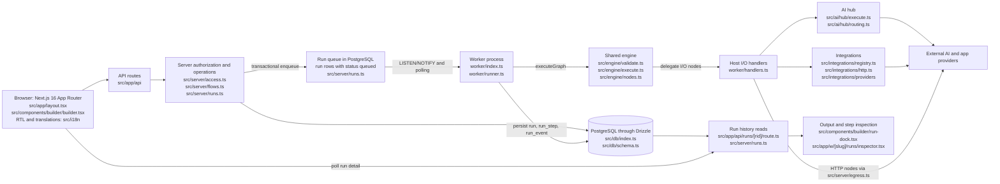
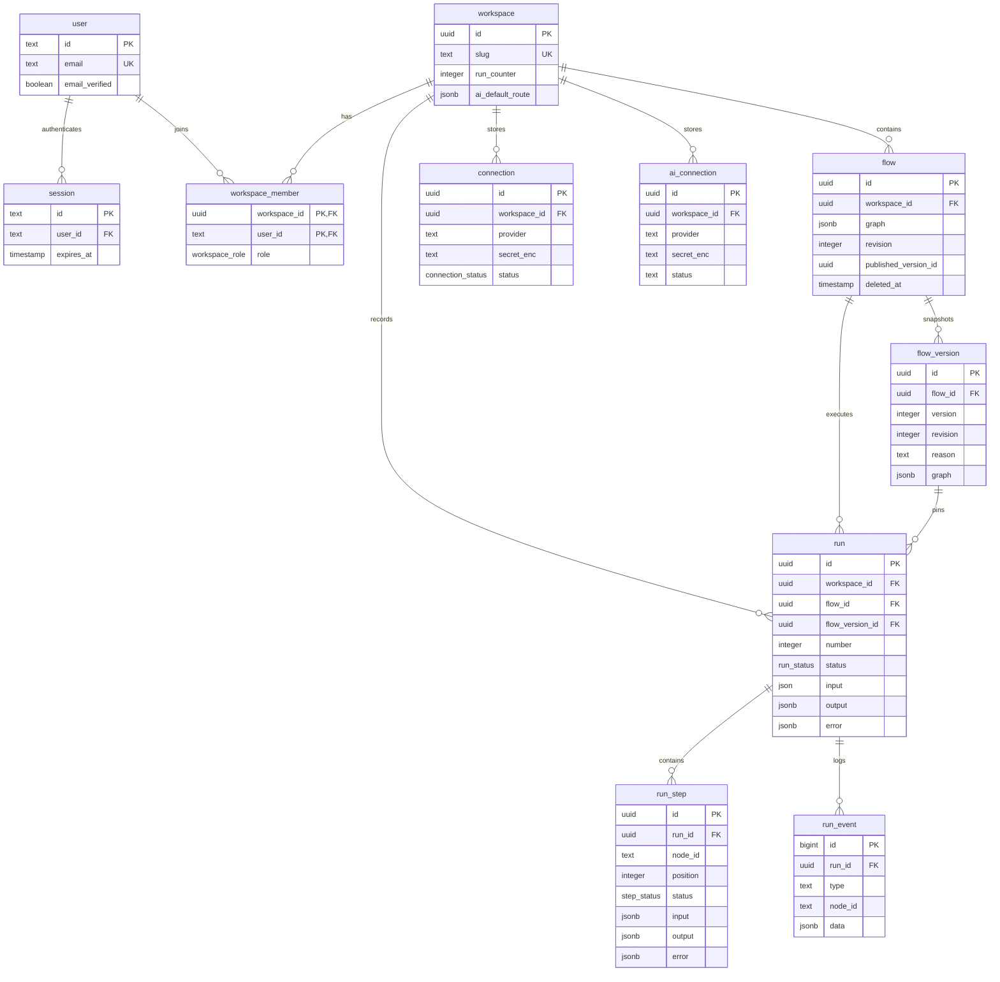

# FlowLine architecture

FlowLine is an Arabic-first visual workflow application built with Next.js 16 App Router, React, and a separate execution worker. The Stage 1 journey in the charter at the top of `AGENTS.md` is to sign in with email and password, enter a default workspace, choose a template or connect three canvas nodes (Input/Trigger → AI Step → Output Action), click Run against a configured real AI provider, and inspect the output. PostgreSQL stores the graph, its execution snapshot, and each run's results. Stage 1 targets sign-in within 60 seconds and output within three minutes; these are goals, not verified timings.

Code reference: `1eceed2bd7093df29b77aecabf161bda0f351754`. Stage 1 scope (charter) and contributor rules both live in `AGENTS.md`.
The current `src/app/app/page.tsx` still redirects users without completed onboarding or a workspace to onboarding.
`src/lib/auth.ts` requires email verification, and `src/server/beta.ts` can enforce invitation-only sign-up. The charter's frictionless entry is a target, not the current universal behavior.

## Runtime



The queue is the `run` table, not a separate broker. `worker/index.ts` listens on `flowline_runs` and also polls.
`worker/runner.ts` claims work with transaction locks and `FOR UPDATE SKIP LOCKED`, respects workspace concurrency, and maintains a lease heartbeat.
The web app uses the engine for validation; the worker supplies I/O handlers to its executor. Provider results return through the handlers and engine before persistence.

## User clicks Run

```mermaid
sequenceDiagram
  actor U as User
  participant B as src/components/builder/builder.tsx
  participant A as src/app/api routes
  participant S as src/server/flows.ts and runs.ts
  participant D as PostgreSQL
  participant W as worker/index.ts and runner.ts
  participant E as src/engine/execute.ts
  participant H as worker/handlers.ts
  participant P as AI hub or integration adapter
  U->>B: Click Run, startRun()
  Note over B: Check online, role, conflicts, validation, active run; lock click
  opt Pending local edits
    B->>A: PUT /api/flows/{fid} via use-persistence.ts
    A->>A: requireUser(), requireFlow(flow.edit)
    A->>S: saveFlow(baseRevision, graph)
    S->>D: Check revision, save draft, increment revision
    D-->>B: Saved flow through server and API
    Note over B: A failed save stops the Run request
  end
  B->>A: POST /api/flows/{fid}/runs with clientRequestId
  A->>A: requireUser(), requireFlow(flow.run), parse input, rate check
  A->>S: enqueueRunEx(triggerKind manual, click dedupe key)
  S->>D: Lock flow and workspace, check duplicate and limits
  S->>S: validateGraph(), insertVersion(reason run), sampleInputFor()
  S->>D: Insert flow_version, queued run, pending run_step rows, run_event, usage
  S->>D: pg_notify(flowline_runs, run id), commit
  S-->>A: Run and duplicate flag
  A-->>B: 202 queued run, or 200 existing duplicate
  Note over B,S: Invalid graph returns 422; rejected requests do not reach execution
  D-->>W: Notification or next poll finds queued work
  W->>D: claimNextRun(), mark running, acquire lease
  W->>D: Load pinned flow_version, workspace, prior steps; recheck actor access
  W->>E: executeGraph(graph, input, handler=createHandler(context))
  loop Each ready node, subject to dependencies
    E->>W: onStepStart()
    W->>D: Persist running step and step_started event
    opt Node requires external I/O
      E->>H: HostHandler(node, input, env)
      H->>P: executeAi() or integration action with runtime credentials
      P-->>H: Provider output, metadata, or error
      H-->>E: NodeOutcome
    end
    E->>W: onStepDone()
    W->>D: Persist redacted result, encrypted resume data, events
  end
  E-->>W: Run status, output, error
  W->>D: Persist final result, or release lease while waiting for approval
  loop While run needs refresh
    B->>A: GET /api/runs/{rid}
    A->>A: requireUser(), requireRun()
    A->>S: getRunDetail()
    S->>D: Read run, ordered steps, version, approvals, events
    S-->>B: Redacted detail through API
    B-->>U: RunDock output, statuses, link to full inspector
  end
```

The concrete routes are `src/app/api/flows/[fid]/route.ts`, `src/app/api/flows/[fid]/runs/route.ts`, and `src/app/api/runs/[rid]/route.ts`.
`src/components/builder/use-persistence.ts` saves edits before enqueue. The canvas sends no explicit input payload, so the server uses the trigger's sample payload.
`src/engine/execute.ts` executes built-in trigger, transform, logic, CSV, and output nodes directly; AI, HTTP, files, and app actions use worker handlers.
The builder polls active run detail every 700 ms, with a slower interval for approval waits. Execution is asynchronous; a queued response does not mean success.
Retries, cancellation, stale-worker recovery, and approval or uncertain-outcome pauses remain in the existing execution path.

## Modules and Stage 1 scope

ACTIVE means the charter permits work for the core journey. FROZEN means existing code stays, with no expansion until Stage 1 has ten active external users.
The charter allows frozen-path edits only for build-breaking imports. Status does not certify live provider behavior or disable existing modules.

| Module | Responsibility | Key files | Stage 1 status |
| --- | --- | --- | --- |
| Landing and auth | Entry screens and Better Auth email/password sessions | `src/app/page.tsx`, `src/app/(auth)/sign-in/page.tsx`, `src/lib/auth.ts` | ACTIVE |
| Arabic and RTL | Locale, direction, translations, language switching | `src/i18n/config.ts`, `src/i18n/client.tsx`, `src/i18n/server.ts`, `src/app/layout.tsx` | ACTIVE |
| Workspace shell and flows | Workspace navigation, draft creation, optimistic saves | `src/app/w/[slug]/layout.tsx`, `src/app/w/[slug]/flows/dashboard.tsx`, `src/server/flows.ts` | ACTIVE |
| Canvas and validation | Graph editing, node definitions, connection rules, publishing | `src/components/builder/builder.tsx`, `src/engine/nodes.ts`, `src/engine/validate.ts`, `src/server/publish.ts` | ACTIVE |
| Worker and execution | Claim runs, execute nodes, handle files, persist results | `worker/index.ts`, `worker/runner.ts`, `worker/handlers.ts`, `src/engine/execute.ts` | ACTIVE |
| AI hub | Workspace model selection, routing, provider calls, metering | `src/ai/hub/execute.ts`, `src/ai/hub/routing.ts`, `src/app/w/[slug]/settings/ai-providers.tsx` | ACTIVE |
| Webhooks and app actions | Signed triggers, authorized connections, external actions | `src/app/api/hooks/[token]/route.ts`, `src/server/connections.ts`, `src/integrations/registry.ts`, `src/integrations/http.ts` | ACTIVE |
| Templates and run history | Template graphs, run list, per-step output inspection | `src/engine/templates.ts`, `src/app/w/[slug]/templates/page.tsx`, `src/app/w/[slug]/runs/inspector.tsx` | ACTIVE |
| Shared persistence and access | PostgreSQL schema, tenant checks, capability enforcement for the core journey | `src/db/schema.ts`, `src/db/index.ts`, `src/server/access.ts`, `src/server/permissions.ts` | ACTIVE |
| Federated MFA and ZITADEL | Federated identity and session assurance | `src/server/zitadel-auth.ts`, `src/server/federated-mfa.ts` | FROZEN |
| Enterprise SSO | Workspace OIDC sign-in | `src/server/sso.ts`, `src/server/oidc.ts`, `src/app/w/[slug]/settings/sso.tsx` | FROZEN |
| Company Builder | Interview, plans, installations, sample trials | `src/company-builder/model.ts`, `src/components/company-builder/session.tsx`, `src/server/company-builder/api.ts` | FROZEN |
| Platform admin and rewrap | Platform credentials, settings, administration, key rewrapping | `src/app/admin/page.tsx`, `src/server/platform-secrets.ts`, `src/server/rewrap.ts` | FROZEN |
| Enterprise audit | Workspace audit recording and display | `src/server/audit.ts`, `src/app/w/[slug]/settings/audit-log.tsx` | FROZEN |
| Custom OAuth apps and public v1 API | Workspace app credentials and scoped API invocation | `src/server/oauth-apps.ts`, `src/app/w/[slug]/settings/oauth-apps.tsx`, `src/app/api/v1/flows/route.ts` | FROZEN |
| Billing and complex entitlements | Sandbox payment adapters, plans, entitlement limits | `src/billing/service.ts`, `src/server/entitlements.ts`, `src/server/prices.ts` | FROZEN |
| Copilot, agents, and knowledge | Draft proposals, agent execution, retrieval | `src/server/copilot.ts`, `worker/agent-runner.ts`, `src/server/knowledge.ts` | FROZEN |

## Data model

`src/db/schema.ts` defines the following core tables. Names and columns below are SQL names, not Drizzle's camelCase exports.



`flow.graph` is the mutable draft. Every run pins one immutable `flow_version`; manual runs snapshot the saved draft, while webhooks and schedules use the published version.
Only publication assigns `flow_version.version`; save, overwrite, and run snapshots leave it null. `flow.published_version_id` is an application-managed pointer without a declared foreign key.
`run_step` is unique on `(run_id, node_id)`. `run` has a per-workspace unique number and deduplicates non-null `(flow_id, trigger_kind, trigger_ref)`.
`run.input` uses PostgreSQL `json` to preserve input key order for CSV output; graphs and most result payloads use `jsonb`.
Additional supporting tables include `account` and `verification` for auth, `file_object` for uploaded bytes, `webhook_endpoint` and `webhook_event` for signed deliveries, `schedule` and `schedule_fire` for timed triggers, `worker_heartbeat`, `approval`, `usage_event`, and `ai_attempt`.
Enterprise tables also remain in the schema; the scope table governs changes to those modules.

## Cross-cutting rules

- Better Auth lives in `src/lib/auth.ts`. Tenant access goes through `src/server/access.ts`: 404 for non-members, 401 without authentication, 403 for missing capabilities. The worker rechecks actor membership before execution.
- Arabic is the default. `src/i18n/messages/ar.json` is the source of truth; `src/i18n/messages/en.json` has matching keys. Strings use `useT` or `getT`; catalog translations use stable IDs. Use logical CSS and keep code, URLs, and credentials LTR.
- The charter requires secrets from env at runtime, never committed. Existing code differs: `src/server/crypto.ts` encrypts provider credentials in PostgreSQL using root keys from env. `src/ai/hub/credentials.ts` refuses an environment-key fallback. This is a current mismatch with the charter's literal env-only rule.
- Tests use `FLOWLINE_ENV=test`, `flowline_test` or `flowline_test_<suffix>`, and web port 3100. `scripts/test-stack.cjs` defines isolated overrides and fake-provider port 4010. Development uses port 3000 and a separate database. Stop the test-stack worker before integration tests with `pnpm stop:test`.
- `.github/workflows/gate.yml` runs static, unit, contract, integration, and selected Chromium checks on ready PRs and main pushes. Manual `tier=full` adds all Chromium specs, Firefox, and WebKit. Docs-only changes skip tests. Main requires `gate` and `docs`, enforced with `.github/workflows/docs.yml`. `AGENTS.md` also requires CodeQL, CodeRabbit review, and the hub's `e2e-army` status for AI PRs.
